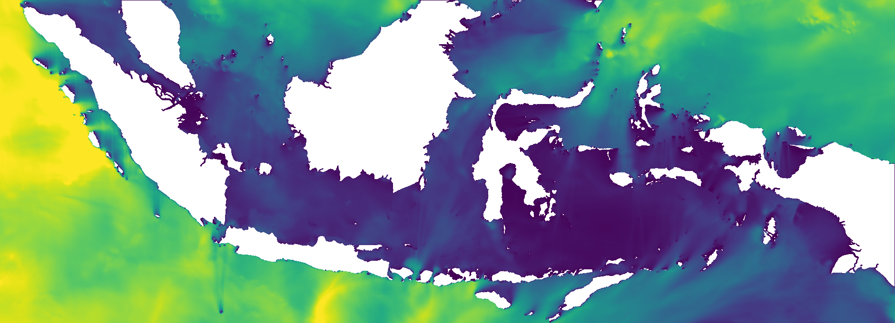
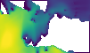
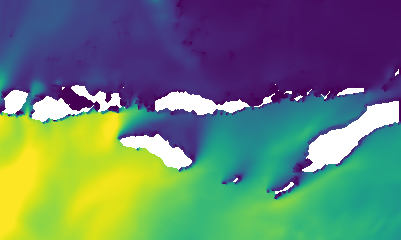
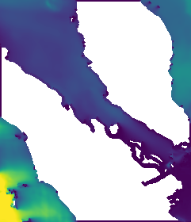
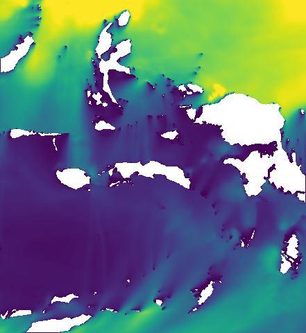

# InaCAWO Coastal Fill Report

_Generated 2026-11-19 09:33 UTC_

## Purpose

Compare coastal NaN extrapolation for InaCAWO Wave and Flows near coastlines: **raw** vs **gaussian** vs **iterative**, then **gaussian + Natural Earth 10m land crop** so only ocean / nearshore cells remain. Interactive maps: [`index.html`](index.html).

## Data

- Wave: `/scratch/bmkg_opn/Production_Unit/CAWO_OUTPUTS/Combined/2026/11/InaCAWOWave_20261118_1200.nc`
- Flow: `/scratch/bmkg_opn/Production_Unit/CAWO_OUTPUTS/Combined/2026/11/InaCAWOFlows_20261118_1200.nc`
- Time index: `0`
- Variables: `hs` (wave); `u`, `v` at `depth=0` (flows)

## Methods

| Step | Detail |
|------|--------|
| Gaussian | `inpaint.fill_nans(..., method='gaussian', stddev=1.0)` |
| Iterative | `method='iterative', max_iter=200, tol=1e-4` (seed = global nanmean, then 3×3 diffusion) |
| Land crop | Natural Earth **10m** land rasterized to model grid; `binary_erosion` iterations = 1; land → NaN |
| Coastal-gain | Cells that are NaN in raw, ocean after NE mask, and finite after gaussian+NE |

## Regions

| ID | Name | Lon | Lat | Stride |
|----|------|-----|-----|--------|
| `indonesia` | Nasional (Indonesia) | 94.0–141.0 | -11.0–6.0 | 3 |
| `selat_sunda` | Selat Sunda | 104.5–107.0 | -7.0–-5.5 | 1 |
| `nusa_tenggara` | Nusa Tenggara | 116.0–126.0 | -12.0–-6.0 | 1 |
| `bali` | Bali | 114.4–115.8 | -9.0–-7.8 | 1 |
| `selat_malaka` | Selat Malaka | 98.0–104.0 | -1.0–6.0 | 1 |
| `maluku` | Maluku | 124.0–135.0 | -9.0–3.0 | 1 |

## Interactive map

Open [`index.html`](index.html) (requires network for OSM + Leaflet CDN). Use region / variable selectors and layer buttons. NE 10m coastline is drawn as a vector overlay; `other_coastlines` is reserved for future BMKG hires or alternative shorelines.

## Metrics

### Nasional (Indonesia) (`indonesia`)

| Var | NaN raw | NaN G+NE | NaN I+NE | Gain G | Gain I | |Δ| hole | |Δ| NE | t_g | t_i |
|-----|---------|----------|----------|--------|--------|---------|-------|-----|-----|
| `hs` | 31,131 | 27,424 | 27,424 | 3,738 | 3,738 | 0.2926 | 0.0024 | 0.11 | 0.24 |
| `u` | 31,570 | 27,424 | 27,424 | 4,160 | 4,160 | 4.9401 | 0.1404 | 0.11 | 0.23 |
| `v` | 31,570 | 27,424 | 27,424 | 4,160 | 4,160 | 5.0264 | 0.1159 | 0.11 | 0.23 |

### Selat Sunda (`selat_sunda`)

| Var | NaN raw | NaN G+NE | NaN I+NE | Gain G | Gain I | |Δ| hole | |Δ| NE | t_g | t_i |
|-----|---------|----------|----------|--------|--------|---------|-------|-----|-----|
| `hs` | 2,176 | 1,981 | 1,981 | 214 | 214 | 0.3315 | 0.0153 | 0.01 | 0.02 |
| `u` | 2,176 | 1,981 | 1,981 | 214 | 214 | 2.3390 | 0.0959 | 0.01 | 0.02 |
| `v` | 2,176 | 1,981 | 1,981 | 214 | 214 | 1.7185 | 0.0989 | 0.01 | 0.02 |

### Nusa Tenggara (`nusa_tenggara`)

| Var | NaN raw | NaN G+NE | NaN I+NE | Gain G | Gain I | |Δ| hole | |Δ| NE | t_g | t_i |
|-----|---------|----------|----------|--------|--------|---------|-------|-----|-----|
| `hs` | 8,962 | 8,259 | 8,259 | 858 | 858 | 0.1468 | 0.0005 | 0.04 | 0.13 |
| `u` | 8,962 | 8,259 | 8,259 | 858 | 858 | 2.3893 | 0.0140 | 0.03 | 0.13 |
| `v` | 8,962 | 8,259 | 8,259 | 858 | 858 | 1.7918 | 0.0113 | 0.03 | 0.13 |

### Bali (`bali`)

| Var | NaN raw | NaN G+NE | NaN I+NE | Gain G | Gain I | |Δ| hole | |Δ| NE | t_g | t_i |
|-----|---------|----------|----------|--------|--------|---------|-------|-----|-----|
| `hs` | 684 | 619 | 619 | 81 | 81 | 0.1539 | 0.0036 | 0.00 | 0.01 |
| `u` | 684 | 619 | 619 | 81 | 81 | 2.5298 | 0.1021 | 0.00 | 0.01 |
| `v` | 684 | 619 | 619 | 81 | 81 | 2.0768 | 0.0833 | 0.00 | 0.01 |

### Selat Malaka (`selat_malaka`)

| Var | NaN raw | NaN G+NE | NaN I+NE | Gain G | Gain I | |Δ| hole | |Δ| NE | t_g | t_i |
|-----|---------|----------|----------|--------|--------|---------|-------|-----|-----|
| `hs` | 39,684 | 38,490 | 38,490 | 1,327 | 1,327 | 0.2887 | 0.0077 | 0.06 | 0.12 |
| `u` | 40,055 | 38,490 | 38,490 | 1,680 | 1,680 | 6.8053 | 0.2237 | 0.07 | 0.12 |
| `v` | 40,055 | 38,490 | 38,490 | 1,680 | 1,680 | 7.1175 | 0.2456 | 0.07 | 0.12 |

### Maluku (`maluku`)

| Var | NaN raw | NaN G+NE | NaN I+NE | Gain G | Gain I | |Δ| hole | |Δ| NE | t_g | t_i |
|-----|---------|----------|----------|--------|--------|---------|-------|-----|-----|
| `hs` | 24,098 | 21,590 | 21,590 | 2,803 | 2,803 | 0.1478 | 0.0010 | 0.13 | 0.31 |
| `u` | 24,416 | 21,590 | 21,590 | 3,109 | 3,109 | 3.7976 | 0.0846 | 0.14 | 0.31 |
| `v` | 24,416 | 21,590 | 21,590 | 3,109 | 3,109 | 2.3938 | 0.0326 | 0.14 | 0.30 |

## Notes / next steps

- Prefer **gaussian + NE crop** for operational coastal fill; iterative is shown for method contrast (can over-diffuse into land holes before masking).
- Next coastline comparison: add BMKG `land_mask_hires` (or other) into `other_coastlines` GeoJSON in the HTML payload without changing the fill API.
- Regenerate: `python generate_report.py` from this directory (env `ofscawo`).
